# Awesome Self-Service Data Preparation & Cleaning

  

  
  
  
  
  

> 🚀 A curated list of top **Self-Service Data Preparation and Cleaning** platforms, tools, and libraries — featuring visual ETL builders, no-code data wrangling interfaces, automated dataset profiling, entity deduplication engines, and open-source software for transforming and standardizing messy data without writing boilerplate code.

---

## 📈 Sector Overview & Market Dynamics

The global data preparation and cleaning software market was valued at approximately **$5.0B – $7.6B in 2024–2025** and is projected to surpass **$26B to $54B by 2030–2035**, expanding at a robust CAGR of **18%–26%** driven by the exponential demand for AI-ready, audit-compliant training and analytical data. The sector is **moderately fragmented**: mega-cap cloud and business intelligence ecosystems (Amazon Web Services, Salesforce Tableau) anchor heavy enterprise workloads, while visual automation suites (Alteryx, Zoho) and an innovative crop of open-source dataframe and AI data-cleaning frameworks (OpenRefine, Cleanlab, Miller, qsv) capture domain-specific, privacy-first, and local-first data wrangling niches.

---

## 📋 Table of Contents

- [📈 Sector Overview & Market Dynamics](#-sector-overview--market-dynamics)
- [🟦 SaaS / Hosted Platforms](#-saas--hosted-platforms)
- [🟩 Open-Source Software](#-open-source-software)
- [📊 Comparison at a Glance](#-comparison-at-a-glance)
- [⭐ Star History](#-star-history)
- [💖 Support](#-support)
- [🤝 Contributing](#-contributing)
- [📄 License](#-license)

---

## 🟦 SaaS / Hosted Platforms

Commercial, cloud-hosted Self-Service Data Preparation and Cleaning platforms. The table below is sorted by company size (valuation / market capitalization) in descending order:

| 🏢 Platform | 💰 Company Valuation / Revenue | 💳 Pricing (Starting Tier) | 🎁 Free Tier / Free Trial Limits | 🔍 Description & Key Capabilities |
|---|---|---|---|---|
| **AWS Glue DataBrew** | **~$2.1T – $2.3T** Market Cap (Amazon AMZN) / ~$184B AWS Ann. Run Rate | **$1.00 per 30-min interactive session**; **$0.48 per node-hr** for batch/recipe jobs | **First 40 interactive sessions free** for first-time users; 1M Glue Data Catalog objects & requests/mo free | Cloud-native visual data preparation service with 250+ built-in transformations and automated profiling, deeply integrated with AWS S3, Redshift, and Athena without managing infrastructure. |
| **Tableau Prep** | **~$180B – $200B** Market Cap (Salesforce CRM) / $15.7B Acq. | **$75 per user/month** (billed annually, bundled in Tableau Creator) | **14-day free trial** (Full exploratory access to Tableau Desktop, Prep Builder, and Tableau Cloud; no credit card required) | Flow-based visual data preparation tool designed to shape, clean, pivot, and combine messy data sources directly within the broader Salesforce and Tableau analytics ecosystem. |
| **Zoho DataPrep** | **~$12.5B** Valuation (Bootstrapped) / ~$1.4B Annual Revenue | **$40 per month** (billed annually, up to 2M rows processed/mo, 3 users) | **Free forever plan**: Up to **20,000 rows processed per month** and **1 user** | Self-service data preparation and pipeline service providing automated data cleansing, rule-based transformation, and validation within the Zoho enterprise business suite. |
| **Alteryx Designer Cloud** | **$4.4B** Acquisition Valuation / >$1B ARR | **$250 per user/month** (Starter Edition, billed annually at $3,000/user/yr, 1–10 seats) | **30-day free trial** (Full exploratory access to Alteryx One Designer Cloud for flat files and basic data prep; business email required) | Visual data profiling and analytics automation platform (formerly Trifacta) offering interactive recipe creation, pattern recognition, and workflow orchestration. |
| **Datameer** | **~$140M – $160M** Valuation / ~$15M – $20M Annual Revenue | **~$100 per month** starting user plan (+ underlying Snowflake compute credit costs) | **14-day free trial** (Test-drive environment pushdown into Snowflake instance; no credit card required) | SaaS data transformation and preparation tool purpose-built for Snowflake, featuring a spreadsheet-like visual formula interface that compiles directly into Snowflake SQL. |

---

## 🟩 Open-Source Software

Self-hosted, community-driven data preparation, wrangling, and cleaning tools. The list below is sorted by **GitHub Stars** in descending order:

### 1. OpenRefine 
* **Repository:** [OpenRefine/OpenRefine](https://github.com/OpenRefine/OpenRefine) 🌐
* **Stack:** Java ☕ | **License:** BSD-3-Clause 📜
* **Key Strengths:** The gold standard desktop tool for exploring and cleaning messy tabular data. Runs locally in your browser to maintain total privacy while offering faceted navigation, clustering algorithms for fuzzy deduplication, cell value normalization, and reconciliation with external web services and Wikidata.  
* **Best for:** Data analysts, researchers, and journalists needing interactive, local data cleanup and entity matching without coding.

### 2. Cleanlab 
* **Repository:** [cleanlab/cleanlab](https://github.com/cleanlab/cleanlab) 🌐
* **Stack:** Python 🐍 | **License:** AGPL-3.0 📜
* **Key Strengths:** The leading data-centric AI library for automated dataset hygiene. Uses confident learning algorithms to automatically detect label errors, outliers, duplicate samples, and data leakage across tabular, image, text, and audio datasets.  
* **Best for:** Machine learning engineers preparing training data and auditing datasets for data quality issues.

### 3. Miller 
* **Repository:** [johnkerl/miller](https://github.com/johnkerl/miller) 🌐
* **Stack:** Go / C 🐹 | **License:** BSD-2-Clause 📜
* **Key Strengths:** Like `awk`, `sed`, `cut`, `join`, and `sort` for name-indexed tabular formats including CSV, TSV, JSON, and JSON Lines. Extremely fast, lightweight, and streaming-friendly for large files that exceed memory.  
* **Best for:** Developers, DevOps, and data engineers needing instant command-line data wrangling, reformatting, and column manipulation.

### 4. Dedupe 
* **Repository:** [dedupeio/dedupe](https://github.com/dedupeio/dedupe) 🌐
* **Stack:** Python / C++ 🐍 | **License:** MIT 📜
* **Key Strengths:** Machine learning-powered Python library that uses active learning to quickly de-duplicate datasets and find fuzzy record matches (entity resolution). Learns human similarity judgements with minimal training labels.  
* **Best for:** Resolving customer records, inventory deduplication, and entity resolution in large address or contact databases.

### 5. qsv 
* **Repository:** [dathere/qsv](https://github.com/dathere/qsv) 🌐
* **Stack:** Rust 🦀 | **License:** MIT / Unlicense 📜
* **Key Strengths:** Blazing-fast CSV data-wrangling CLI toolkit written in Rust with over 50 subcommands for slicing, indexing, selecting, searching, deduplicating, validating against JSON schemas, and running frequency statistics at line-rate speed.  
* **Best for:** Ultra-fast CLI data validation, indexing, and high-throughput tabular preprocessing.

### 6. DataPrep 
* **Repository:** [sfu-db/dataprep](https://github.com/sfu-db/dataprep) 🌐
* **Stack:** Python / Dask 🐍 | **License:** Apache-2.0 📜
* **Key Strengths:** Low-code data preparation and exploratory analysis library (`dataprep.clean`, `dataprep.eda`). Features 140+ specialized cleaning functions for validating and standardizing standard formats like email addresses, phone numbers, geographic coordinates, and URLs with unified function calls.  
* **Best for:** Fast exploratory data analysis, column sanitization, and standardized format cleaning in Python.

### 7. Skrub 
* **Repository:** [skrub-data/skrub](https://github.com/skrub-data/skrub) 🌐
* **Stack:** Python / Scikit-Learn 🐍 | **License:** BSD-3-Clause 📜
* **Key Strengths:** Specifically engineered to bridge raw tabular data into Scikit-Learn machine learning pipelines. Handles messy string columns, high-cardinality categorical variables, missing values, and date parsing automatically with vectorized encoders (`TableVectorizer`).  
* **Best for:** Data scientists preparing messy tabular data directly for machine learning models.

### 8. Optimus 
* **Repository:** [hi-primus/optimus](https://github.com/hi-primus/optimus) 🌐
* **Stack:** Python / PySpark / Dask / cuDF 🐍 | **License:** Apache-2.0 📜
* **Key Strengths:** Agile data preparation framework providing a unified, human-readable API over multiple distributed engines including Pandas, Dask, cuDF, Vaex, and PySpark. Seamlessly scales cleaning recipes from single laptops to GPU clusters.  
* **Best for:** Teams scaling data cleaning workflows across single laptops, GPU clusters, and Apache Spark environments.

### 9. PyJanitor 
* **Repository:** [pyjanitor-devs/pyjanitor](https://github.com/pyjanitor-devs/pyjanitor) 🌐
* **Stack:** Python / Pandas 🐍 | **License:** MIT 📜
* **Key Strengths:** Python port of R’s acclaimed `janitor` package. Extends Pandas DataFrames with a fluent method-chaining API for expressive cleaning routines: `df.clean_names().remove_empty().fill_empty()`.  
* **Best for:** Python practitioners wanting clean, chained, and readable Pandas data manipulation code.

### 10. Amphi ETL 
* **Repository:** [amphi-ai/amphi-etl](https://github.com/amphi-ai/amphi-etl) 🌐
* **Stack:** Python / Jupyter / TypeScript 🐍 | **License:** Apache-2.0 📜
* **Key Strengths:** Low-code visual data preparation tool designed for Python environments and JupyterLab. Users visually drag and drop ETL pipelines, connect structured and unstructured data sources, and export pure native Python code.  
* **Best for:** Analysts wanting visual drag-and-drop pipeline construction integrated with Python.

### 11. Data Prep Kit 
* **Repository:** [data-prep-kit/data-prep-kit](https://github.com/data-prep-kit/data-prep-kit) 🌐
* **Stack:** Python / Ray / Spark 🐍 | **License:** Apache-2.0 📜
* **Key Strengths:** Community-driven toolkit built to scale data preparation for Large Language Models (LLMs). Provides enterprise-scale modules for PDF/document extraction, deduping, quality filtering, and language identification running on Ray or Spark.  
* **Best for:** AI engineers preparing massive unstructured text and document datasets for generative AI pre-training and fine-tuning.

### 12. Flowfile 
* **Repository:** [Edwardvaneechoud/Flowfile](https://github.com/Edwardvaneechoud/Flowfile) 🌐
* **Stack:** Python / Polars / Delta Lake ⚡ | **License:** Apache-2.0 📜
* **Key Strengths:** Visual pipeline builder and data catalog powered by a Polars engine. Provides 30+ visual transformation nodes (joins, filters, fuzzy matching, pivots) and exports visual flows directly into standalone, high-performance Polars Python scripts.  
* **Best for:** Teams seeking a self-hosted visual alternative to Alteryx with native Polars execution and zero vendor lock-in.

### 13. Open Data Editor 
* **Repository:** [okfn/opendataeditor](https://github.com/okfn/opendataeditor) 🌐
* **Stack:** JavaScript / Frictionless Framework 🟨 | **License:** MIT 📜
* **Key Strengths:** Local-first, no-code desktop application developed by the Open Knowledge Foundation. Validates, corrects, and standardizes tabular datasets offline, ensuring compliance with open data FAIR standards without data leaving the machine.  
* **Best for:** Non-technical domain experts, NGOs, and government agencies seeking offline data validation and publication hygiene.

### 14. Openclean 
* **Repository:** [VIDA-NYU/openclean](https://github.com/VIDA-NYU/openclean) 🌐
* **Stack:** Python 🐍 | **License:** Apache-2.0 📜
* **Key Strengths:** Modular Python library for data profiling, cleansing, and validation from NYU’s VIDA lab. Offers unified APIs for outlier detection, pattern validation, string standardization, and human-in-the-loop cleaning.  
* **Best for:** Research and data science teams building extensible, reproducible data cleaning pipelines.

### 15. Ciaren 
* **Repository:** [ciaren-labs/Ciaren](https://github.com/ciaren-labs/Ciaren) 🌐
* **Stack:** Python / Polars / Pandas 🐍 | **License:** MIT 📜
* **Key Strengths:** Open-source, local-first visual ETL and data preparation builder with step-by-step data preview, data quality assertions, and automated export to clean Pandas or Polars Python code and Jupyter notebooks.  
* **Best for:** Analysts and learners wanting visual drag-and-drop data prep that compiles cleanly into native Python.

### 16. DATADOC 
* **Repository:** [narain-karti/DATADOC](https://github.com/narain-karti/DATADOC) 🌐
* **Stack:** Python / Polars ⚡ | **License:** MIT 📜
* **Key Strengths:** CLI and Python engine for automated, zero-leakage dataset engineering. Built on Polars, it diagnoses missing values and outliers mathematically, isolates transformations to training splits, and exports reproducible pipeline JSON artifacts.  
* **Best for:** Machine learning engineers needing automated, deterministic tabular data engineering.

---

## 📊 Comparison at a Glance

| 🛠️ Software | 📜 Model / License | 🏗️ Core Architecture | 🎨 Visual Canvas | 💾 Script / Code Export | ⚙️ Execution Engine | 🎯 Primary Use Case |
|---|---|---|---|---|---|---|
| **AWS Glue DataBrew** | Proprietary SaaS | Cloud Managed | ✅ | ❌ (Recipe JSON) | AWS Spark / Serverless | Managed cloud data prep for AWS data lakes |
| **Tableau Prep** | Proprietary SaaS | Desktop & Cloud | ✅ | ❌ | Proprietary Engine | Visual prep for Tableau dashboards & reporting |
| **Zoho DataPrep** | Proprietary SaaS | Cloud Managed | ✅ | ❌ | Zoho Cloud Engine | Business user data prep within Zoho suite |
| **Alteryx Designer Cloud** | Proprietary SaaS | Cloud Managed | ✅ | (Limited) | Cloud Worker Nodes | Enterprise visual prep & analytics automation |
| **Datameer** | Proprietary SaaS | Cloud / Snowflake | ✅ (Grid) | ✅ (Snowflake SQL) | Snowflake Pushdown | In-warehouse prep & transformation for Snowflake |
| **OpenRefine** | BSD-3-Clause | Local Web App | ✅ (Browser) | (Operation JSON) | Java (In-Memory) | Interactive messy data cleaning & clustering |
| **Cleanlab** | AGPL-3.0 | Library | ❌ | ✅ Python | NumPy / PyTorch / Scikit | ML dataset auditing & label error correction |
| **Miller** | BSD-2-Clause | CLI Utility | ❌ | ❌ (Shell CLI) | Go / C (Streaming) | High-speed command-line tabular wrangling |
| **Dedupe** | MIT | Library | ❌ | ✅ Python | Python / C++ | Machine learning entity resolution & deduplication |
| **qsv** | MIT / Unlicense | CLI Utility | ❌ | ❌ (CLI Pipes) | Rust (Multi-threaded) | Lightning-fast CSV validation & manipulation |
| **DataPrep** | Apache-2.0 | Library | ❌ (Notebook UI) | ✅ Python | Python / Dask | 140+ format sanitizers & exploratory analysis |
| **Skrub** | BSD-3-Clause | Library | ❌ | ✅ Scikit-Learn | Scikit-Learn / Pandas | Vectorizing messy strings for machine learning |
| **Optimus** | Apache-2.0 | Framework | ❌ | ✅ Python | PySpark / Dask / cuDF | Distributed & GPU-accelerated data cleaning |
| **PyJanitor** | MIT | Library | ❌ | ✅ Pandas | Pandas | Expressive method chaining for data cleanup |
| **Amphi ETL** | Apache-2.0 | Local / Web App | ✅ (Visual Flow) | ✅ Python Code | Python / Jupyter | Low-code visual pipeline builder with code export |
| **Data Prep Kit** | Apache-2.0 | Framework | ❌ | ✅ Python | Ray / Spark | Unstructured document & text prep for LLMs |
| **Flowfile** | Apache-2.0 | Local App / Web | ✅ (Visual Flow) | ✅ Polars Python | Polars / Delta Lake | Visual ETL canvas with clean Polars code export |
| **Open Data Editor** | MIT | Desktop App | ✅ (Grid UI) | ❌ | Frictionless Framework | Offline FAIR validation for non-technical users |
| **Openclean** | Apache-2.0 | Library | ❌ | ✅ Python | Python / Pandas | Modular data profiling & cleaning pipelines |
| **Ciaren** | MIT | Desktop / Web | ✅ (Visual Flow) | ✅ Pandas / Polars | Polars / Pandas | Local visual builder exporting plain Python code |
| **DATADOC** | MIT | CLI / Library | ❌ (CLI) | ✅ Python / JSON | Polars | Deterministic tabular ML data engineering |

---

## 🤝 Contributing

Contributions are warmly welcomed! If you know of an open-source data preparation, cleaning, or wrangling tool that should be listed here:

1. 🍴 Fork this repository.
2. 📝 Add your tool to the relevant section (maintaining star count order for open source projects).
3. 🔎 Ensure the project is actively maintained with clear documentation.
4. 🚀 Open a pull request explaining what the tool does and why it stands out.

---

## 💖 Support

A heartfelt thank you for exploring this repository! If this curated list helped you discover new tools or optimize your data workflows:

- ⭐ **Star** this repository to show your appreciation and help others discover it.
- 🍴 **Fork** it to build your own customized collections or contribute back.
- 📢 **Share** it with fellow data engineers, analysts, and researchers across your networks!
- ☕ **Buy a Coffee / Sponsor**: If you appreciate this work and want to support ongoing maintenance and new awesome lists, consider sponsoring via the [GitHub Sponsor Dashboard](https://github.com/sponsors/ishandutta2007).

---

##  Star History

---

## 📄 License

This repository and curated list are licensed under [Creative Commons Zero v1.0 Universal (CC0 1.0)](LICENSE). The individual software tools and libraries listed are property of their respective owners and subject to their own licenses.

---

  ⭐ <b>Star this repository if you found it helpful for your data workflows!</b> ⭐

